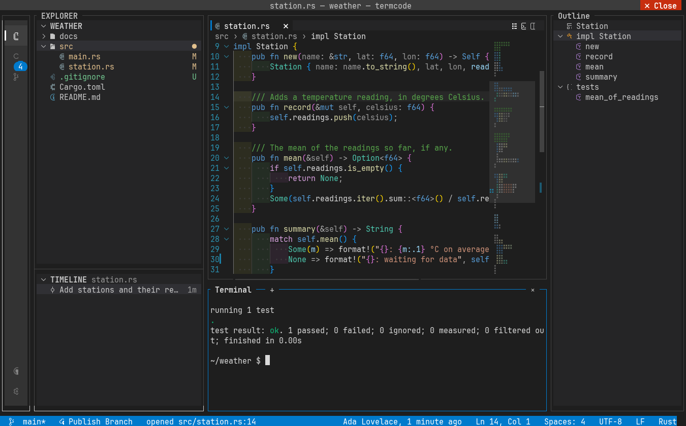
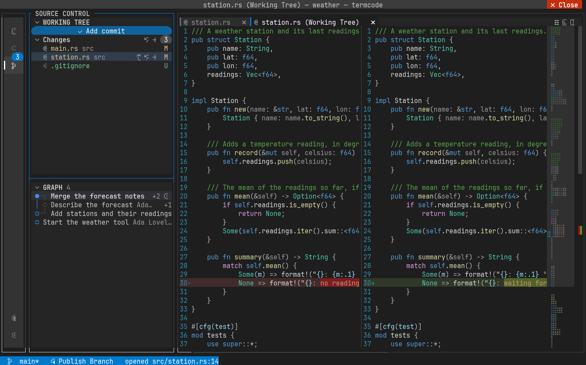
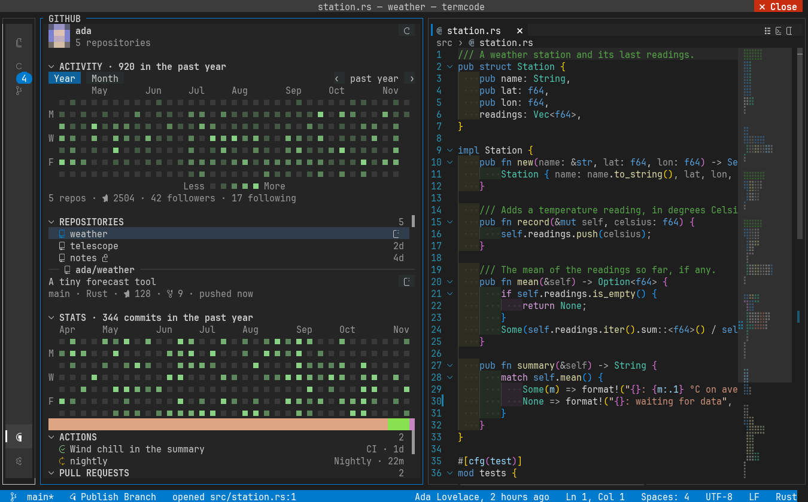

# termcode

A VS Code-style code editor and Git panel that runs **inside your terminal**.

> This repository is where termcode is published, and where you report problems and ask
> for features. It holds no source code.

- Run `termcode` in a folder and it opens right there, like `vim`. Quit and you are back at your shell.
- Inside [herdr](https://herdr.dev), `termcode --tab` opens it as a **Code** tab instead.

What you get: a file Explorer, Search, Source Control with a commit graph, tabs and split
editors, side-by-side diffs, a minimap, Go to Definition, error checking for shell and
C/C++, and VS Code themes.







### Is it for you?

termcode is for working on code where your terminal already is: on a server over SSH, in
tmux or herdr, or whenever a full IDE is too heavy and vim or nano too bare. It has VS
Code's look and keys, but it is not VS Code:

| termcode has | termcode doesn't have |
|---|---|
| Editing, Explorer, Search, Source Control, diffs, a terminal | Extensions |
| Go to Definition and references, found by searching the code | A language server: no completion, no type-aware rename or navigation |
| Error checking for shell scripts and C/C++ | A debugger, remote development |
| VS Code themes and keys | Settings Sync; only the settings its Settings window lists |

Need a language server or extensions? Use VS Code or an editor built on one. termcode is
the quick, light one for everything else.

### How light is it?

Both opening this repo and one file, fresh profiles, median of 5 runs (Linux, 12 cores):

| | termcode | VS Code 1.146 |
|---|---|---|
| Startup | **0.1 s** | 1.0 s |
| Memory (PSS) | **20 MB** | 800–1070 MB |
| Processes | 1 | 11 |
| CPU used in the first 20 s | 0.6 s | 12.4 s |
| CPU when idle | 0.9% | 9% |
| Install size | 8 MB | 1.9 GB |

termcode's numbers leave out the terminal it runs in. VS Code had no extensions and its
startup is its own timer, which leaves out the `code` launcher, so real use is heavier.

---

## 1. Install

termcode runs on Linux (x86_64 or arm64). On Debian or Ubuntu, add its apt repository
once, then install it:

```sh
sudo curl -fsSLo /usr/share/keyrings/termcode.gpg https://jonasatelier.github.io/termcode-releases/termcode.gpg
echo "deb [signed-by=/usr/share/keyrings/termcode.gpg] https://jonasatelier.github.io/termcode-releases stable main" \
  | sudo tee /etc/apt/sources.list.d/termcode.list
sudo apt update && sudo apt install termcode
termcode --version
```

(Or download the package for your machine from
[Releases](https://github.com/JonasAtelier/termcode-releases/releases) and
`sudo apt install ./termcode_*.deb`.)

apt also installs git, ripgrep, xclip (copy and paste) and shellcheck (checks shell
scripts). Optional: clang, to check C/C++ files; [herdr](https://herdr.dev), for termcode
as a Code tab; [Ghostty](https://ghostty.org), the terminal termcode is tested in.

**Everything else at once:** `/usr/share/termcode/setup.sh` sets up what termcode's
features use, as on the machine termcode is made on: clang, readelf and poppler (C/C++
checks, ELF files, PDFs), the GitHub CLI, a Nerd Font, Ghostty, serial port access,
and for the Programmer arduino-cli and ESP-IDF (with herdr, if you use it: the Code tab
and its pictures). It asks before each part (`--yes` takes the defaults, `--all` says
yes to all, `--dry-run` only shows the commands) and leaves what is there alone.

## 2. Fonts and icons (nothing to do)

termcode works with the font your terminal already uses, and picks its icons by itself:

| You have | Icons |
|---|---|
| a [Nerd Font](https://www.nerdfonts.com/font-downloads) installed (any one; the terminal falls back to it) | VS Code's icons |
| no Nerd Font, or termcode runs over SSH | standard Unicode symbols: ❐ ⚲ ⎇ ⚙ ▸ ▾ × ● ✓ |

The Unicode symbols are tested with 13 common fonts: Cascadia Code, DejaVu Sans Mono,
Fira Code, Hack, IBM Plex Mono, Inconsolata, JetBrains Mono, Liberation Mono, Noto Sans
Mono, Roboto Mono, Source Code Pro, Space Mono and Ubuntu Mono. (Where a font lacks one,
the terminal borrows it from DejaVu Sans, which Linux desktops have.)

**Want VS Code's icons?** Install a Nerd Font, e.g. **JetBrainsMono Nerd Font** (on
Linux: unzip into `~/.local/share/fonts/`, then run `fc-cache -f`). Over SSH, install it
on the computer in front of you (its terminal draws the icons) and set
`"termcode.icons": "nerd"`.

To choose yourself, set `termcode.icons` (see [Settings](#settings)) to `"nerd"`,
`"unicode"` or `"ascii"`; `"auto"` is the default.

### Terminals

termcode uses 24-bit colour where the terminal has it, and the nearest of 256 or 16
colours where it doesn't, picked from the terminal's environment (`termcode.colors` or
`TERMCODE_COLORS=truecolor|256|16` overrides it).

| Terminal | Colours | Status |
|---|---|---|
| Ghostty, alone or in herdr | 24-bit | tested |
| tmux 3.6 | 24-bit (tmux converts for the terminal outside) | tested |
| GNU screen 4.9 | 256 or 16 | tested |
| Over SSH | 256 unless `TERM` names a 24-bit terminal; Unicode icons | tested |
| Linux console (`TERM=linux`) | 16 | tested by its environment |
| GNOME Terminal, Ptyxis, Konsole, kitty, WezTerm, Alacritty, foot, iTerm2, Windows Terminal | 24-bit | should work, not tested here |
| macOS Terminal | 256 | should work, not tested here |

## 3. Add it to herdr (optional)

```sh
herdr plugin link /usr/share/termcode
herdr plugin list                        # shows jonasatelier.termcode
```

## 4. Try it

```sh
cd ~/some/project
termcode                 # opens this folder; Ctrl+Q quits
```

Inside a herdr pane:

```sh
termcode --tab           # opens a "Code: project" tab
```

The new tab doesn't take focus: click **Code: project** in the tab bar.

## Updating

```sh
sudo apt update && sudo apt upgrade
```

That's all. A termcode that is already open reloads itself a few seconds later, keeping
its tabs and cursors. It waits while you have unsaved files. To reload by hand: F1, then
**Developer: Reload Window**.

## Uninstalling

```sh
herdr plugin unlink jonasatelier.termcode
sudo apt remove termcode
sudo rm /etc/apt/sources.list.d/termcode.list /usr/share/keyrings/termcode.gpg   # the repository too
```

---

## Using it

### Opening things

```sh
termcode                    # this folder (its git repo if inside one)
termcode ~/proj             # any folder
termcode src/main.rs:120    # a file at line 120 (also :LINE:COL)
termcode --tab src          # the same, as a herdr tab
termcode --new ~/proj       # a second termcode, even inside one's terminal
```

- **From termcode's own terminal:** `termcode PATH` there opens PATH in *this* termcode
  instead of a second one inside it: a file of this folder opens in place; another
  folder switches termcode over to it (your shells keep running, each folder keeps its
  own session). `cd ~/other && termcode .` jumps folders. It waits while a Programmer
  job or a Git write runs, or a file is unsaved. In a herdr Code tab, the folder opens
  as its own tab. (Each termcode has a private socket for this: `$XDG_RUNTIME_DIR/termcode/`.)

- **Quitting:** Ctrl+Q, or Close in the title bar. You are asked about unsaved files first.
- **Sessions:** open the same folder again and your tabs, cursors and layout come back.
  Unsaved text survives a crash too.
- **Subfolders:** `termcode drivers/net` shows only that folder, but Source Control still
  uses the whole repo.
- **Pictures and PDFs:** a PNG, JPEG, GIF, WebP, BMP or ICO opens as the picture (fitted;
  `+` `-` zoom, `0` fits, `1` is actual size, the arrows pan); a PDF as a document, drawn
  by poppler's `pdftoppm`: its pages one under another with a scrollbar (the wheel, the
  arrows, PgUp/PgDn, Home/End; ‹ › go a page; Ctrl+wheel zooms around the mouse; in
  Ghostty and kitty the pages stay in the terminal as tiles, so scrolling only moves
  them), **2 pages** side by side while whole pages fit, its text selected with the
  mouse and copied with Ctrl+C (Ctrl+A: the page), found with Ctrl+F (the whole
  document; Enter goes to the next), its table of contents in the Outline (a click goes
  there). **text** shows its text, a page a heading; `sudo apt install
  poppler-utils` if missing. **hexdump** on the bar shows the bytes. Pictures use the Kitty graphics protocol (Ghostty, kitty),
  half-blocks elsewhere.
- **Keyboard shortcut for the Code tab:** none is set. In herdr, bind `plugin_action`
  `jonasatelier.termcode.open` to a free key.

### The sidebar

| View | Open with | What it does |
|---|---|---|
| Explorer | Alt+1, Ctrl+E | Files. **Timeline** below shows the open file's commits |
| Search | Alt+4, F4 | Search all files. **References** below shows where the symbol at the cursor is used |
| Source Control | Alt+2, F2, Ctrl+G | Changes, commits and the commit graph |
| Programmer | the chip icon above GitHub | STM32CubeProgrammer, Arduino sketches, ESP-IDF projects (below) |

Click the active sidebar icon to hide the sidebar. Drag any divider to resize.

### Common keys

| Key | Does |
|---|---|
| F1 | Command palette (every command is here) |
| Ctrl+P | Open a file by name. Type `:42` to go to a line, `@` for a function |
| Ctrl+S / Ctrl+W / Ctrl+Q | Save / close tab / quit |
| Ctrl+Z / Ctrl+Y | Undo / redo |
| Ctrl+C / Ctrl+X / Ctrl+V | Copy / cut / paste |
| Ctrl+F / Ctrl+H | Find / replace in this file |
| Ctrl+/ | Comment or uncomment lines |
| Ctrl+Shift+Up / Down | Add a cursor above / below |
| Alt+Up / Alt+Down | Move lines up / down |
| Ctrl+Shift+[ / ] | Fold / unfold |
| Alt+Z | Toggle word wrap |
| Ctrl+Shift+V | Markdown: preview ↔ source; a patch: diff ↔ source; a log: log ↔ source (or the buttons on the breadcrumbs' row) |
| `/` · F8 or `n` · End | In a log: filter · next error or warning · follow the end |
| Ctrl+K V | Markdown preview to the side |
| F12 or Ctrl+click | Go to Definition |
| Shift+F12 | Find all references |
| Alt+← / Alt+→ | Go back / forward |
| F7 / Shift+F7 | Next / previous change in a diff |
| Ctrl+PgDn / Ctrl+PgUp | Next / previous tab |
| Ctrl+, | Settings |
| Ctrl+` | Show / hide the terminal |

**Mouse:** click a file to preview it (italic tab), double-click its tab to keep it open.
Double-click a name in the Explorer to rename it. Drag a file to an editor edge to split,
or a file or folder onto a folder in the Explorer to move it there (asked first); hold Ctrl
(or Alt) as you let go to copy it instead, and rest on a closed folder to open it. Ctrl+click
adds items to the selection, Shift+click or Shift+↑↓ selects a range, Ctrl+A all; a drag,
Ctrl+C / Ctrl+X / Ctrl+V and Delete then take them all. Ctrl+V copies or moves into the
selected folder; a name already there becomes `name (1)`, `name (2)` …, and a big folder
copies in the background, counting its files (Esc stops it). Delete moves the selection to the Trash (your file manager
restores it from there; on another disk, that disk's own Trash), Shift+Delete deletes it for
good; each asks first. In the Explorer, Ctrl+Z takes back the last move, rename, paste or
delete (not Shift+Delete), and Ctrl+Y does it again; both survive a reload. Rest the
pointer on a file for its MD5 (**Copy** copies it). A binary file (or a `.bin`) opens as a
hexdump; F1 **View: Toggle Hexdump** shows it as text, or any file as a hexdump. An ELF
file (`.so`, an executable, `.o`, `.ko`) opens as `readelf`'s report, its SONAME, needed
libraries, symbol versions, build ID and compiler summed up first; the **readelf** and
**hexdump** buttons on its banner switch between the two. A symlink has an arrow
after its name (red when broken); rest the pointer on it to see where it points.
Rest the pointer on a function to see its docs.

**Terminal:** Ctrl+` or the terminal button beside Split Editor opens your shell under the
editors. Drag its top edge to resize it. While it has the keys, every key goes to the shell
except Ctrl+`, F1 and Ctrl+Q. Drag over text to copy it (double-click: a word); Ctrl+C
copies a selection, else interrupts. Programs that use the mouse (vim, htop) get it;
Shift+drag still selects. Hiding it keeps the shell running; `exit` closes it. Quitting
while something runs in it asks first. More shells: Ctrl+Shift+` or the `+` on its border
opens another, each with a tab there; click a tab or press Ctrl+PgUp / Ctrl+PgDn to switch,
and `×` closes the one shown (asked while a program runs). Ctrl+F (at the shell's prompt,
not in vim or less) finds text in its scrollback: Enter goes to older matches, Shift+Enter
newer, Esc back to the bottom. A reload (a new termcode installed) keeps the shells and
what runs in them, with what they showed.

**GitHub:** the GitHub item above Settings (or F1 **View: Show GitHub**), in any folder.
Its top pane is your account: your contribution graph as on your GitHub profile (Year or
Month, ‹ › to go back; hover a day for its count, click one for its month), all your
repositories, review requests, your pull requests,
issues assigned to you and unread notifications. Pick a repository there (click or Enter)
and the bottom pane shows it: description, visibility, default branch, language, stars,
forks, last push; its stats (a commit graph for the past year, its languages, its top
contributors); then its Actions runs, pull requests and issues. The editor area shows the
repository too, as github.com does. Its main page: the latest commit, the files and
folders each with its last commit, insights (pull requests and issues open, merged and
closed; languages; the year's commits as a heat map; commits by weekday and hour; lines
added and removed a week; top contributors), then the README. On the right, a button back
to the main page and the files as a tree. Click a file for its code in the middle
(read-only; it scrolls, selects, finds and copies as any editor), its outline under the
tree. Click the branch at the top right to switch the branch. Tab moves between the
panes; drag the line between them to resize. It needs the [GitHub CLI](https://cli.github.com)
(`gh`): signed out, it offers **Sign in with GitHub**, which runs `gh auth login` in the
terminal, so termcode never sees a password or token. On a row: Enter or `o` opens it in
the browser, `e` edits its title, `c` checks a pull request out (into this folder's
repository), `r` re-runs a run, `x` closes an issue or cancels a run, F5 refreshes. Every
change asks first.

**Outline:** the outline button beside it (or F1 **View: Toggle Outline**) lists the
file's functions and types on the right, nested. The one the cursor is in is lit; click one
to go there (double-click: and type there). Click a ▾ to fold. With the keys
(F1 **View: Focus Outline**): ↑ ↓ move, ← → fold and unfold, Enter goes there, Esc goes
back. Drag its left edge to resize it.

Some terminals (GNOME Terminal, Ptyxis) can't send Ctrl+Shift keys, Ctrl+Tab or
Ctrl+1/2/3. Use F1 or the other key in the table instead, or bind your own.

### Your own keys

Any F1 command can have a key. Add `termcode.keybindings` to your settings file, the key
on the left and the command's name as F1 shows it on the right:

```jsonc
"termcode.keybindings": {
    "ctrl+alt+p": "Git: Pull",
    "f6": "View: Close Editor",
    "alt+left": "Go Back",
    "ctrl+q": ""                  // "" turns a key off
}
```

Keys are `ctrl`, `alt` and `shift` joined with `+` to a letter, digit, symbol, `f1`-`f24`,
`enter`, `tab`, `esc`, `space`, `backspace`, `delete`, `home`, `end`, `pageup`,
`pagedown` or an arrow (`up`, `down`, `left`, `right`). Your keys come before the
default ones, and F1 shows them next to their commands. A key or command name that
doesn't exist is a settings error (a notification says which).

### Error checking

Shell scripts and C/C++ files are checked as you work. A problem gets a **red** (error),
**yellow** (warning) or **blue** (info) underline; rest the pointer on it to read why.
The scrollbar marks where they are.

| Files | Checked by | When |
|---|---|---|
| `.sh`, `.bash`, scripts with a `#!/bin/sh` or `bash` line | `shellcheck` | as you type (after a short pause) |
| `.c`, `.h`, `.cpp`, … | the project's compiler, else `clang` | when you open or save the file |

C/C++ needs the project's include folders and flags. termcode finds them in:

1. a `compile_commands.json` in the project (or its `build/` folder), or
2. a **built Linux kernel tree**: nothing to set up, the build's `.o.cmd` files are read.

If the compiler named there isn't installed (a cross-compiler such as
`aarch64-…-gcc`), `clang` checks the file for that target instead. Other projects can
make a `compile_commands.json` with:

```sh
cmake -B build -DCMAKE_EXPORT_COMPILE_COMMANDS=ON   # CMake projects
bear -- make                                        # Make projects
```

Without either, termcode guesses (the file's folder and the repo's `include/`). If a
header still can't be found, the status bar says so instead of showing false errors.

A project's `compile_commands.json` never runs anything of its own: termcode runs only a
compiler found on your `PATH` by name (gcc, clang, cc, …, else clang), and passes only
the flags that change how code is read, never ones that load plugins or write files.

Turn error checking off with `"termcode.errorChecking": false`.

### Source Control

- **Changes:** `+` stages a file, `−` unstages it, `↶` discards (always asks).
- **Commit:** click **Add commit**. Stage files, write a message, then **Commit** or
  **Commit & Push**. Your draft is kept if you cancel. In the message, a drag selects (a
  double-click, a word), and Ctrl+C, Ctrl+X and Ctrl+V copy, cut and paste.
  In its diff, a drag selects one side's text (a double-click, a word) and Ctrl+C copies it.
- **Graph:** click a commit to see its files, click a file to see its diff. Rest the pointer
  on a commit (or press `i`) for a card with **Copy hash** and **Open changes**; drag over
  its message to select it, Ctrl+C copies.
- **Status bar:** click the branch to switch or create one; click `↓1 ↑2` to pull and push;
  click `Ln, Col` to go to a line. Every item lights up under the pointer.
- **More Git:** F1, then type `Git:` for pull, push, fetch, stash, merge, rebase and more.
  Risky ones ask first.
- **Merge conflicts:** click **Accept Current**, **Accept Incoming** or **Accept Both** above
  each conflict, save, then `+` to mark it resolved.

**Repositories from elsewhere.** A repository's own git settings can make git run a
program just by reading it (`core.fsmonitor`, `diff.external`, textconv drivers,
filters). If the repository you open has any, termcode keeps git off and Source Control
lists them with a **Trust Repository** button. Trusted repositories are remembered; if
those settings change, you are asked again. Hooks, ssh, credential helpers and gpg run
only when you commit, pull or push, as they do with git in a shell.

Git runs in the background and never asks for a password inside the panel. If a command
hangs, click the spinner in the status bar to cancel it. F1 **Git: Show Git Output** shows
what ran.

### Programmer (STM32)

The chip icon (above GitHub) does what STM32CubeProgrammer does, through ST's
`STM32_Programmer_CLI`: pick a feature on the left, its page opens in the editor area,
and the tool's output with a progress bar shows in the panel below (its **Programmer**
tab, beside **Terminal**). Every page starts with the target (its name, Connect or
Disconnect); a running job shows its progress there too, programming step by step
(Erase › Download › Verify › Run). **F5** runs the page's main action. Fields such as
Address and Size are typed in place: Enter takes the value (in Memory, reads there), a
bad one says why in red. Closing the page's tab goes back to the Explorer.

| Feature | What it does |
|---|---|
| Device | Port (SWD, JTAG), mode (Normal, Under reset, Hot plug), speed, the ST-LINK probe; **Connect** reads the target (then **Disconnect**), **Reset Target** resets it |
| Memory | Reads an address range into a grid as CubeProgrammer's: address, 8-, 16- or 32-bit values, ASCII; **Save As…** writes it to a `.bin` |
| Program | Writes a `.bin` (at the address given), `.hex`, `.elf`, `.srec` or `.s19`; verify, full erase first, reset and run after. Click the file (or **Browse…**) to pick it folder by folder, from your home folder |
| Erase | The full chip, or sectors (`0-3`, `0 1 2`); each asks first |
| Option Bytes | Shows them, read only |
| Serial Console | The target's UART output (its `printf`) through the ST-LINK's virtual COM port, in the panel's **Serial** tab; **Send…** writes a line to it |

The switch at the top of the view picks the tool: **STM32Cube** (above), **Arduino** or
**ESP-IDF**. Each takes any target it knows, given what it needs:

| Tool | Give it | Pages |
|---|---|---|
| Arduino (`arduino-cli`) | a sketch folder (its `.ino`) and the board's FQBN | **Boards** (what it sees: port, name, FQBN; pick one), **Sketch** (Compile, Upload, verify after), **Serial Console** on the board's port |
| ESP-IDF (`idf.py`) | a project folder (`CMakeLists.txt`, `main/`) | **Project** (Build, Flash, Erase Flash, the target chip: set-target asks first), **Serial Console** |

The sketch or project is found in the workspace (or above the open file), or picked
with **Browse…**. Uploading or flashing takes the Serial Console's port for its time
and gives it back. ESP-IDF is found through `$IDF_PATH`, Espressif's installer's record
(`~/.espressif/idf-env.json`) or `~/esp/esp-idf`; termcode loads its `export.sh` itself.
Without a tool, an **Install** button runs its installer in the terminal.

Without the tool, the view has an **Install** button: it runs ST's installer from
`~/Downloads/en.stm32cubeprg-lin*.zip` in the terminal, or opens ST's download page (ST
asks you to sign in to download it). termcode finds the tool on `PATH`, in
`~/STMicroelectronics/STM32Cube/STM32CubeProgrammer/bin` or in STM32CubeIDE.

---

## Settings

Press **Ctrl+,** (or click the gear at the bottom left). Change things, then:

- **Apply** to try them out,
- **Save** to keep them.

Prefer a file? The first time termcode starts it writes
**`~/.config/termcode/settings.json`**, listing every option of the Settings window at its
default, commented out. To change one, remove the `//` in front of it and edit the value;
saving applies it. F1 **Preferences: Open Settings (JSON)** opens the file from inside
termcode. A broken file never crashes the panel: a notification says what is wrong, and
the last good settings stay.

```jsonc
    // "termcode.icons": "auto",                          // Icons: "auto", "nerd", "unicode", "ascii"
    "termcode.icons": "unicode",                         // <- uncommented and changed
```

Lost track of the defaults? `termcode --default-config` prints the full list again.

A few more examples:

```jsonc
{
    "workbench.colorTheme": "Default Dark Modern",   // any VS Code theme you have installed
    "workbench.colorCustomizations": { "statusBar.background": "#3B3B3B" },
    "workbench.density": "compact",                  // tighter layout
    "termcode.icons": "unicode",                   // no Nerd Font needed
    "editor.tabSize": 8,
}
```

<details>
<summary>All settings</summary>

| Key | Default | Meaning |
|---|---|---|
| `workbench.colorTheme` | "Visual Studio Dark - C++" | A VS Code theme name, or a path to a theme JSON |
| `workbench.colorCustomizations` | `{}` | Override UI colours, also per theme (`"[Theme Name]": {…}`) |
| `editor.tokenColorCustomizations` | `{}` | Override code colours (`comments`, `strings`, `textMateRules`, …) |
| `termcode.followVSCode` | `false` | Take the three keys above from your VS Code settings |
| `workbench.density` | `"comfortable"` | or `"compact"` |
| `termcode.spacing` | per density | Fine-tune sizes, see below |
| `termcode.icons` | `"auto"` | `"nerd"`, `"unicode"` (any font) or `"ascii"`; auto picks nerd when a Nerd Font is installed here |
| `termcode.blocks.style` | `"cards"` | `"cards"` rounded boxes, `"lines"` shared lines, `"none"` flat |
| `termcode.fileIcons` | `{}` | Custom file icons: `extensions`, `fileNames`, `folderNames` → `{ "glyph", "color" }` |
| `indentRainbow.enabled` | `true` | Colour each indent level |
| `indentRainbow.indicatorStyle` | `"classic"` | `"light"`: a thin line instead of a background |
| `indentRainbow.colors`, `.errorColor`, `.tabmixColor` | the extension's | Rainbow colours |
| `indentRainbow.excludedLanguages`, `.includedLanguages`, `.ignoreErrorLanguages`, `.ignoreLinePatterns` | as the extension | Where the rainbow applies |
| `editor.tabSize` | `4` | Tab width |
| `editor.guides.indentation` | `true` | Indent guide lines |
| `editor.renderWhitespace` | `"boundary"` | `"none"`, `"selection"`, `"trailing"`, `"all"` |
| `editor.occurrencesHighlight` | `"singleFile"` | Highlight the word under the cursor; `"off"` |
| `editor.matchBrackets` | `"always"` | Highlight matching brackets; `"never"` |
| `editor.bracketPairColorization.enabled` | `true` | Colour brackets by depth |
| `editor.wordWrap` | Markdown only | `"on"` or `"off"` for every file |
| `editor.autoClosingBrackets`, `editor.autoClosingQuotes` | `"always"` | Auto-close pairs; `"never"` |
| `editor.rulers` | `[90]` | Vertical lines at these columns; `[]` for none |
| `editor.minimap.enabled` | `true` | The code overview on the right |
| `editor.minimap.side` | `"right"` | or `"left"` |
| `editor.minimap.showSlider` | `"always"` | or `"mouseover"` |
| `editor.minimap.size` | `"fill"` | `"proportional"` or `"fit"` |
| `editor.minimap.renderCharacters` | `true` | `false`: blocks instead of dots |
| `editor.minimap.maxColumn` | `120` | Columns the minimap covers |
| `termcode.minimap.minEditorWidth` | `40` | Hide the minimap when the editor gets narrower |
| `editor.gotoLocation.multipleDefinitions` | `"peek"` | `"gotoAndPeek"` or `"goto"` |
| `breadcrumbs.enabled` | `true` | The path row under the tabs |
| `files.trimTrailingWhitespace` | `true` | On save, on edited lines |
| `files.insertFinalNewline` | `true` | On save |
| `workbench.tree.enableStickyScroll` | `true` | Keep the current folder pinned while scrolling |
| `explorer.autoReveal` | `true` | Show the active editor's file in the Explorer (its folders opened, it selected) |
| `workbench.tree.stickyScrollMaxItemCount` | `1` | More than 1: nested rows, like VS Code |
| `termcode.colors` | `"auto"` | `"truecolor"`, `"256"` or `"16"`; auto reads the terminal's environment |
| `termcode.keybindings` | `{}` | Your own keys for F1 commands, see [Your own keys](#your-own-keys) |
| `termcode.errorChecking` | `true` | Underline problems in shell scripts and C/C++ files |
| `termcode.restoreSession` | `true` | Reopen last session's tabs |
| `workbench.editor.restoreViewState` | `true` | Restore cursor and scroll per file |
| `git.blame.statusBarItem.enabled` | `true` | Line author in the status bar |
| `git.blame.editorDecoration.enabled` | `false` | Line author after the cursor line |
| `git.confirmSync` | `true` | Ask before pull + push |

`termcode.spacing` keys (comfortable / compact): `sidebarWidth` 36/30,
`sidebarPadding` 2/0, `sectionGap` 1/0, `editorPadding` 0/0, `tabPadding` 2/1,
`statusBarGap` 3/3, `statusBarPadding` 2/1, `activityBarWidth` 5/3, `listItemGap` 0/0,
`popupPadding` [3,1]/[0,0], `iconGap` 2/1, `treeIndent` 2/2, `titleBarPadding` 2/1,
`buttonPadding` 2/1, `findWidgetPadding` 1/0.

Environment variables: `TERMCODE_ICONS=nerd|unicode|ascii` (`0`: ascii) and
`TERMCODE_COLORS=truecolor|256|16` override their settings;
`TERMCODE_GRAPHICS=kitty|blocks|text` picks how Settings draws its controls.

</details>

## Where files are kept

| What | Where |
|---|---|
| Settings | `~/.config/termcode/settings.json` |
| Sessions, layout, unsaved-file backups, commit drafts | `~/.local/state/termcode/` |

Upgrading from herdr-code? Your settings and sessions are copied to these folders the
first time termcode starts.

## Troubleshooting

| Problem | Fix |
|---|---|
| Colours look wrong (a yellow or garish background) | Set `"termcode.colors": "256"` (or `"16"`), or `COLORTERM=truecolor` if your terminal has 24-bit colour |
| Icons show as boxes or `?` | Set `"termcode.icons": "unicode"` (a Nerd Font was found here but your terminal can't use it), or see step 2 |
| The Code tab doesn't open | Restart herdr after fixing `PATH`; check `herdr plugin list` |
| Ctrl+Shift keys do nothing | Your terminal doesn't send them; use F1, the other key, or [your own key](#your-own-keys) |
| Source Control says "Git is off" | The repository's own settings run programs; trust it there if you know where it came from |
| No error underlines | Install `shellcheck` / `clang` (the status bar says which, once) |
| C/C++ says a header is not found | Build the kernel once, or add a `compile_commands.json` (see [Error checking](#error-checking)) |
| A file opens read-only | It is over 16 MB / 500,000 lines, binary, or not UTF-8 |

## Performance

Measured 2026-11-17 on an Intel i5-12500 (12 threads, 16 GB RAM, Ubuntu), each editor
opening the same copy of termcode's source and its 2,374-line `src/panel/mod.rs`. Medians
of 5 runs (VS Code: 3), after one warm-up run.

| | termcode 0.4.0 | nvim 0.12 `--clean` | nvim 0.12 + LazyVim | VS Code 1.146 |
|---|---|---|---|---|
| Start, until the file's text is on screen | 100 ms | 61 ms | 109 ms | 1,006 ms ¹ |
| Memory (PSS, all its processes) | 19 MB | 11 MB | 44 MB | 949 MB (8 processes) |
| CPU while idle | 0% | 0% | 1.0% | 3.1% |
| A key to the screen changing, p50 / p95 ² | 11.7 / 14.1 ms | 11.2 / 12.1 ms | 18.7 / 29.6 ms | not measured |
| A 200,000-line log (13 MB): open / memory | 177 ms / 54 MB | 64 ms / 25 MB | 362 ms / 52 MB | 1,276 ms ¹ / 1,359 MB |
| Installed | 12 MB, one file | 40 MB | 40 MB + 302 MB of plugins | 573 MB (snap) |

- The terminal editors ran in tmux (120×40); "on screen" is the first frame tmux shows
  with the file's text.
- ¹ VS Code's own startup time (`--prof-append-timers`): from its main process starting
  to its workbench being ready, without the snap's launch. It ran with a new profile and
  no extensions, under Xwayland with software rendering (the snap could not load the GPU
  driver here).
- ² Down sent through tmux, until tmux's screen changes, so a few milliseconds are tmux's.
  VS Code's GUI could not be driven from the test.
- A file over 16 MB opens read-only and only its first 16 MB
  (see [Troubleshooting](#troubleshooting)), so the big file is 13 MB: all of it in
  every editor.

## Known limits

- No language server: Go to Definition and References search the code with `rg`, so some
  definitions (C++ methods in a class body, macro-built names) are missed.
- Error checking covers shell scripts and C/C++ only. A C/C++ problem's underline hides
  once you edit its line, until the next save.
- In files over 50,000 lines the minimap colours only the parts you have scrolled
  through (colouring it all would keep the CPU busy).
- Find matches inside one line only. Lines over 4000 bytes aren't syntax-coloured.
- Light themes that don't set every colour get some dark panels.
- Mouse back/forward buttons don't reach the panel (herdr drops them).

## Reporting problems

Press **F1** and run **Help: Report Issue**: it copies your termcode version, system,
terminal and settings summary, and the last error termcode hit, if any (check it before
you paste). Then open an issue at
[termcode-releases](https://github.com/JonasAtelier/termcode-releases/issues/new/choose)
and paste it.

If termcode crashes, unsaved files are kept and offered back when you open them again;
the next start reminds you to report it. Errors are logged in
`~/.local/state/termcode/panic.log`.

## License

termcode is free to install and use, for any purpose, on any number of computers. It may
not be modified, resold or redistributed. The license comes with it, in
`/usr/share/doc/termcode/copyright`.

## Credits

The default colours and `assets/vscode_dark_defaults.json` come from VS Code (MIT, Microsoft);
`assets/seti.json` from Seti UI (MIT, Jesse Weed). See `assets/vscode_LICENSE.txt`.
The Rust crates termcode is built with, and their licenses, are listed in
`/usr/share/doc/termcode/THIRD-PARTY-LICENSES`.
